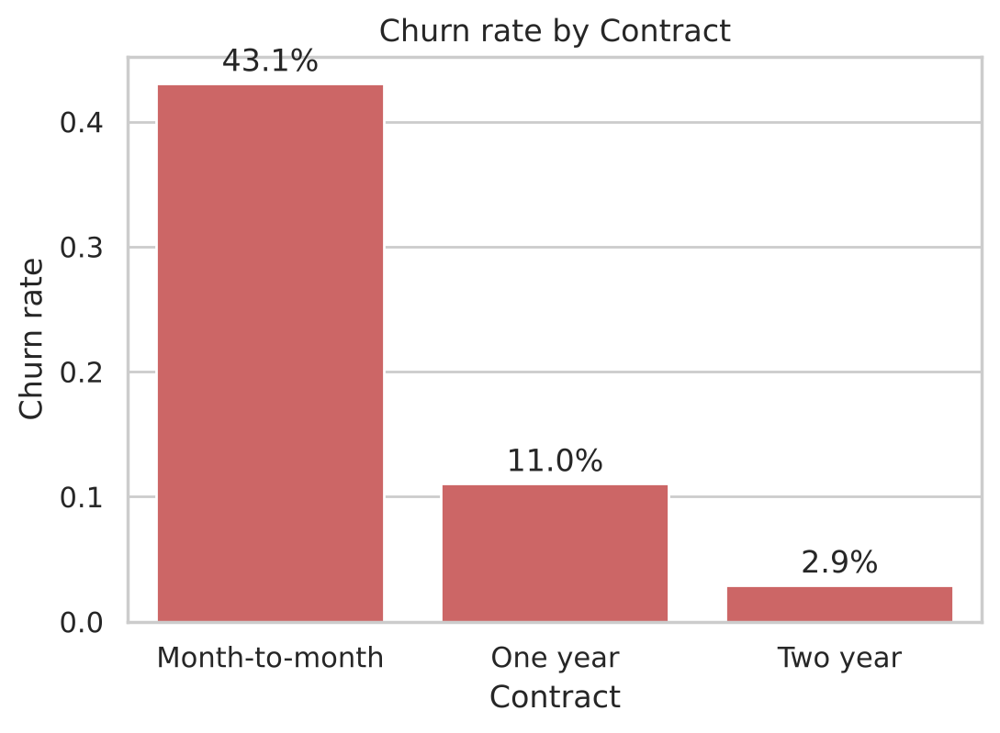
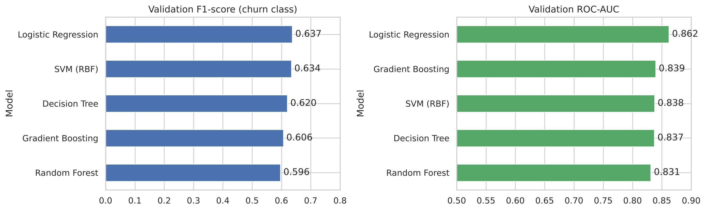
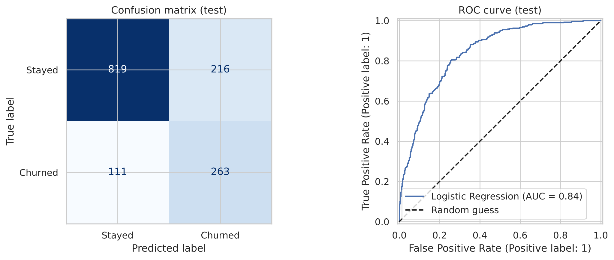

# Telco Customer Churn Prediction

An end-to-end machine learning project that predicts which telecom customers are likely to leave the company (churn).

**Author:** Waseem Said Mahmoud

## Project goal

Customer churn is expensive: keeping a customer usually costs less than finding a new one. The goal of this project is to build a classification model that predicts, for each customer, whether he or she will churn. With an early warning, a company can contact at-risk customers with a retention offer in time.

- **Problem type:** binary classification (`Churn` = Yes / No)
- **Main metric:** F1-score of the churn class (the data is imbalanced, so accuracy alone is misleading)
- **Supporting metrics:** ROC-AUC, recall, precision

## Dataset

- **Source:** [Telco Customer Churn](https://www.kaggle.com/datasets/blastchar/telco-customer-churn) on Kaggle (IBM sample data)
- **Size:** 7,043 customers, 21 columns (19 features, 1 ID, 1 target)
- **Content:** customer details, services, contract, billing and tenure
- **Target balance:** 26.5% of customers churned

## Tools used

- **Python 3**
- **pandas, NumPy:** loading, cleaning and feature engineering
- **scikit-learn:** train/validation/test split, scaling, encoding, models, GridSearchCV, evaluation
- **Matplotlib, Seaborn:** EDA and result charts
- **Jupyter Notebook:** analysis and documentation

## Workflow

1. **Split first:** 60% train, 20% validation, 20% test (stratified, `random_state=42`).
2. **EDA** on the training set only.
3. **Cleaning:** fixed `TotalCharges` (text to number), filled 11 blanks for new customers with 0, made labels consistent, removed the customer ID.
4. **Feature engineering:** `num_addon_services`, `has_protection`, `is_autopay`, `tenure_group`, log transform of `TotalCharges`; dropped `gender` (no effect).
5. **Preparation:** `StandardScaler` and `OneHotEncoder`, fitted on the training set only (no data leakage).
6. **Five models compared** on the validation set: Logistic Regression, Decision Tree, Random Forest, Gradient Boosting, SVM.
7. **Tuning:** `GridSearchCV` (5-fold cross-validation on training data) and a decision-threshold search.
8. **Final test:** the test set was used once, at the end.

## Results

Best model: **Logistic Regression** (tuned).

| Metric (test set) | Value |
|---|---|
| F1-score | 0.617 |
| ROC-AUC | 0.840 |
| Recall | 0.703 |
| Precision | 0.549 |
| Accuracy | 0.768 |

The model finds 263 of the 374 customers who left (70%). Flagged customers are about 2x more likely to leave than the average customer (55% vs. 26.5%).

## Key findings

- **More churn:** month-to-month contracts, short tenure, fiber optic internet, electronic check payment, higher monthly charges.
- **Less churn:** one- and two-year contracts, longer tenure.
- **Recommendation:** focus retention offers on month-to-month customers in their first year (longer contracts, automatic payment, tech support).

## Limitations

- Prototype built on public data; it must be validated on real company data before use.
- F1 is moderate (about 0.62): roughly 45% of the alerts are false alarms.
- The test set has only 374 churners, so the results carry some uncertainty.
- The data is a one-month snapshot with no reasons for leaving.

## How to run

1. Download the dataset from [Kaggle](https://www.kaggle.com/datasets/blastchar/telco-customer-churn) (`WA_Fn-UseC_-Telco-Customer-Churn.csv`) and place it in the same folder as the notebook. The dataset is not included in this repository.
2. Install the libraries: `pip install -r requirements.txt`
3. Open `Telco_Churn_ML_Project.ipynb` in Jupyter and run all cells. Results are reproducible (`random_state = 42`).

## Repository contents

- `Telco_Churn_ML_Project.ipynb`: full analysis (code, charts, results)
- `Telco_Churn_Summary.pdf`: short summary deck
- `requirements.txt`: Python libraries
